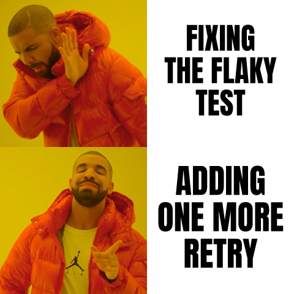
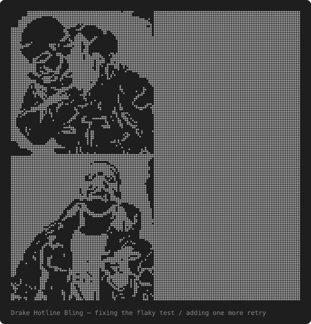

# memes

A Claude Code mod that lets Claude post a reaction meme with an English caption.

| In the Claude apps | In a terminal |
| --- | --- |
|  |  |

- Where the surface can draw images (the Claude desktop and mobile apps, and terminals that show images), Claude shows the meme as a picture with the caption drawn on it.
- In other terminals, Claude shows the meme as 80-column braille art. The caption is on the line below it.

58 classic templates are included. Each template has hand-placed caption boxes.

## Install

At the prompt of a Claude Code terminal session:

```
/plugin install memes --marketplace minchenlee/memes-mod
```

Answer `y` to add the marketplace, then press Enter to pick the user scope.

From a shell:

```
claude plugin install memes --marketplace minchenlee/memes-mod
```

In the desktop app, where `/plugin` does not run: click + next to the prompt box, then Plugins, Add marketplace with `minchenlee/memes-mod`, then Add plugin.

## Use

### Ask for a meme

```
/memes:meme [topic]
```

- `/memes:meme the build finally passed` asks Claude for one meme about that topic.
- `/memes:meme` with no topic asks for a meme about what just happened in the conversation.

### See the commands and the current frequency

```
/memes:help
```

Shows the commands and the meme frequency set in /config. It answers at once and does not use a turn.

### Claude posts memes on its own

You do not have to ask. When a moment fits, Claude posts a meme by itself, for example:

- A fix finally works, or a bug turns out to be a typo.
- Tests pass after several tries, or a build is slow.
- A plan backfires, or there is a choice between two options.

By default, Claude posts about one meme every few turns of real work, and never more than one per turn. You can change this (see below). This also applies when another agent hands Claude the task. After a meme, Claude continues the work and does not explain the meme.

Claude does not post a meme when you are upset or when something serious broke (data loss, production down, a security problem).

### Choose how often

Open `/config` and find **Meme frequency** under the memes plugin. Pick one:

| Value | What Claude does |
| --- | --- |
| `off` | Posts no meme on its own. `/memes:meme` still works. |
| `rare` | Posts a meme only at a big moment, such as the end of a long bug hunt. Most sessions get none. |
| `normal` (default) | About one meme every few turns of real work. |
| `often` | Posts a meme whenever a moment fits, in most turns of real work. |

In every value, Claude posts at most one meme per turn and skips memes when something serious broke. The change applies from your next prompt, also in a session that is already open.

Each prompt you send carries a short note for Claude that you do not see: the frequency and how many turns have passed since the last meme. Each session keeps its own count in the plugin's `assets/counts/` folder, so a `/config` change does not reset it, and sessions open side by side do not mix their counts. A new session starts the count at 0.

To get fewer memes in one session only, tell Claude, for example "no more memes in this session".

To turn off the plugin completely, including `/memes:meme`:

```
/plugin disable memes
```

Or from a shell: `claude plugin disable memes`. To turn it back on, use `enable` in place of `disable`.

## Templates

All 58 templates, with the situation each one is for:

<details>
<summary>Show the list</summary>

| Template | Name in the tool | Use it for |
| --- | --- | --- |
| Drake Hotline Bling | `drake-hotline-bling` | rejecting one thing for another: "worse / better" |
| Two Buttons | `two-buttons` | torn between two bad options: "option A / option B" |
| Distracted Boyfriend | `distracted-boyfriend` | ditching the current thing for a shiny new one: "new shiny / me / current thing" |
| UNO Draw 25 | `uno-draw-25-cards` | would rather suffer than do the obvious thing (the card already says "or draw 25"): "the obvious thing / me" |
| Bernie Asking Again | `bernie-i-am-once-again-asking-for-your-support` | asking for the same thing yet again (the picture already says "I am once again asking"): "for …" |
| Left Exit 12 | `left-exit-12-off-ramp` | swerving from the sensible path: "sensible path / tempting exit / me" |
| Running Away Balloon | `running-away-balloon` | pulled away from what you want: "me / the goal / the thing in the way" |
| Anakin and Padmé | `anakin-padme-4-panel` | a confident plan, then an ominous silence: "plan / you will do it right, right? / … / right?" |
| Epic Handshake | `epic-handshake` | two unlikely sides agree on something: "side A / side B / what they agree on" |
| Always Has Been | `always-has-been` | a realisation that it was always so: "wait, it was X all along? / always has been" |
| Waiting Skeleton | `waiting-skeleton` | waiting forever (CI, a build, a reply): "me waiting for …" |
| Gru's Plan | `gru-s-plan` | a plan whose last step backfires: "step 1 / step 2 / oops / oops" |
| Disaster Girl | `disaster-girl` | calmly causing chaos: "the disaster / me" |
| Sad Pablo Escobar | `sad-pablo-escobar` | waiting alone, nothing happens: "waiting for …" |
| X, X Everywhere | `x-x-everywhere` | something shows up everywhere: "X / X everywhere" |
| This Is Fine | `this-is-fine` | everything is on fire but carrying on (the picture already says "this is fine"): "what is on fire" |
| Surprised Pikachu | `surprised-pikachu` | shocked by an entirely predictable result: "did the risky thing / it broke / :O" |
| Mocking Spongebob | `mocking-spongebob` | mocking a claim by repeating it: "the claim / tHe ClAiM" |
| Change My Mind | `change-my-mind` | a hot take (the sign already says "change my mind"): "the hot take" |
| Woman Yelling At Cat | `woman-yelling-at-cat` | an angry accusation met with a smug reply: "accusation / smug reply" |
| Batman Slapping Robin | `batman-slapping-robin` | shutting down a bad idea mid-sentence: "bad idea… / NO" |
| Is This A Pigeon | `is-this-a-pigeon` | confidently misnaming something: "me / the thing / is this …?" |
| Buff Doge vs. Cheems | `buff-doge-vs-cheems` | the strong past vs the weak present: "then / now" |
| Expanding Brain | `expanding-brain` | ever more absurd "smarter" solutions: "idea 1 / idea 2 / idea 3 / idea 4" |
| They're The Same Picture | `theyre-the-same-picture` | two things that are identical (the picture already says "they're the same picture"): "A / B" |
| Marked Safe From | `marked-safe-from` | escaped a disaster (the picture already says "marked safe from"): "the disaster" |
| 0 Days Without | `zero-days-without` | the same mistake happened again (the sign already says "0 days without"): "the mistake" |
| Squidward Window | `squidward-window` | watching others have fun while stuck: "others / me stuck with …" |
| Megamind Peeking | `megamind-peeking` | sly "no X?" question: "no …?" |
| Tuxedo Winnie The Pooh | `tuxedo-winnie-the-pooh` | the same thing, but with a fancy name: "plain name / fancy name" |
| One Does Not Simply | `one-does-not-simply` | something that is never simple: "one does not simply …" |
| Roll Safe | `roll-safe` | galaxy-brained loophole: "can't have bugs if …" |
| Hide the Pain Harold | `hide-the-pain-harold` | smiling through pain: "when … / and you smile anyway" |
| Monkey Puppet | `monkey-puppet` | awkward look away after getting caught: "when someone asks about …" |
| Clown Applying Makeup | `clown-applying-makeup` | step-by-step self-delusion: "belief 1 / belief 2 / belief 3 / clown" |
| Spider-Man Pointing | `spiderman-pointing` | two of the same blaming each other: "A / B" |
| Panik Kalm Panik | `panik-kalm-panik` | panic, relief, then worse panic: "bad news / it's fine / it's not fine" |
| Scooby-Doo Mask Reveal | `scooby-doo-mask-reveal` | root cause revealed: "the mystery bug / let's see who this really is / it was …" |
| Flex Tape | `flex-tape` | a quick patch over a big problem: "the problem / the patch" |
| Evil Kermit | `evil-kermit` | tempted by the bad idea: "me / me: do the bad thing" |
| Bike Fall | `bike-fall` | sabotaging yourself, then blaming something else: "me / my own mistake / blaming the tool" |
| Trade Offer | `trade-offer` | a lopsided deal (the picture already says "I receive / you receive"): "what I receive / what you receive" |
| Y'all Got Any More | `yall-got-any-more` | craving more of something: "y'all got any more of that …" |
| Absolute Cinema | `absolute-cinema` | something went perfectly: "absolute cinema" |
| Bell Curve | `bell-curve` | novice and expert agree, the midwit overthinks: "simple / overthought / simple" |
| Leonardo Cheers | `leonardo-cheers` | a toast to something good: "cheers to …" |
| Futurama Fry | `futurama-fry` | unsure between two readings: "not sure if … / or …" |
| Grim Reaper Knocking | `grim-reaper-knocking` | one by one things die: "thing 1 / thing 2 / next victim" |
| Domino Effect | `domino-effect` | a tiny cause, a huge effect: "tiny cause / huge effect" |
| Ancient Aliens | `ancient-aliens` | blaming an absurd cause: "…? aliens" |
| Sleeping Shaq | `sleeping-shaq` | ignoring a real problem, alarmed by a trivial one: "real problem / trivial thing" |
| Laughing Leo | `laughing-leo` | smug laughter at a situation: "when …" |
| Two Guys On A Bus | `two-guys-on-a-bus` | the gloomy view next to the cheerful one: "gloomy side / bright side" |
| Scroll Of Truth | `scroll-of-truth` | an unwelcome truth rejected (the picture already says "NYEH"): "the truth" |
| I'm The Captain Now | `im-the-captain-now` | taking over control: "I'm the … now" |
| We Are Not The Same | `we-are-not-the-same` | a smug comparison: "you … / I … / we are not the same" |
| Mother Ignoring Kid | `mother-ignoring-kid` | doting on the new thing while the old one drowns: "new thing / old thing" |
| Boardroom Suggestion | `boardroom-suggestion` | the one sensible idea gets thrown out: "question / idea / idea / the sensible idea" |

</details>

## First run

The meme images are not in this repository. On the first session start, the mod downloads these files into its `assets/` folder:

- The 58 template images, from `i.imgflip.com`.
- The [resvg](https://github.com/linebender/resvg) v0.47.0 binary for your platform, checked against its sha256.
- The Anton font (SIL Open Font License), from google/fonts, checked against its sha256.

The download needs `curl` and `tar`, and takes about 6 seconds. If it fails, the mod tries again on the next meme.

Where resvg has no binary for the platform (for example Linux on ARM), Claude sends the template image without a caption.

## Uninstall

At the prompt of a Claude Code session:

```
/plugin uninstall memes
/plugin marketplace remove memes-mod
```

Or from a shell:

```
claude plugin uninstall memes
claude plugin marketplace remove memes-mod
```

The downloaded images, resvg and the font are only in the plugin's own `assets/` folder. The mod writes nothing outside the plugin folder.

## Notes

- Captions are English only. Claude rewrites non-ASCII captions in English.
- Tested on macOS. Windows and Linux are not tested yet.
- The template images belong to their owners. This repository does not include them, except in the two example pictures in `docs/`.

## Credits

Thanks to [@chungchihhan](https://github.com/chungchihhan). The idea for this mod grew out of discussions with him.

## License

The code is under the [MIT License](LICENSE). The template images and the Anton font are not part of this license: the images belong to their owners, and Anton is under the SIL Open Font License.
